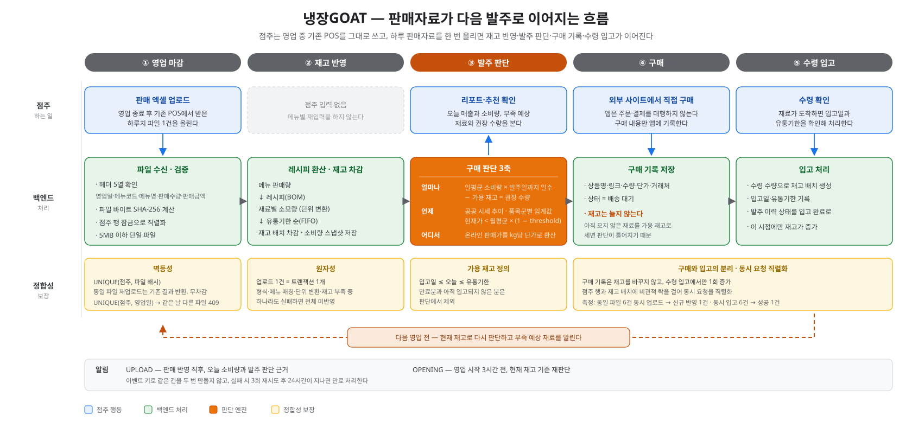

# NaengjangGOAT

> **A food inventory and purchasing decision-support platform that connects existing POS sales data with public market prices.**
>
> Turning food purchasing decisions from intuition into data.

[Korean README](README.md) · [Backend Repository](https://github.com/gm-15/naengjang-goat_backend)



## Project Overview

| Item | Description |
|---|---|
| Period | Mar 2, 2026 – Oct 16, 2026 |
| Program | Software Capstone Design |
| Team | 3 members |
| Role | Backend Lead |
| Core workflow | POS sales data → Inventory update → Price comparison → Purchase recommendation → Purchase record → Goods receipt |
| Tests | 75 passed, 0 failures or errors (13 test classes) |
| Field validation | Results shared with two stores and feedback collected |

NaengjangGOAT connects daily sales spreadsheets exported from a restaurant's existing POS system to inventory data. It combines public market prices and online product prices to support purchasing decisions.

- The system calculates and recommends **shortage forecasts and purchase quantities** based on sales, inventory, and the time remaining until the next purchasing day.
- The owner **makes purchases directly on external vendor websites**.
- **Purchase records and physical goods receipt are managed separately.** Items awaiting delivery are not counted as available inventory.
- NaengjangGOAT **does not place orders or process payments on behalf of the owner**. Owners move to external vendor websites to complete purchases.

## Background and Problem Definition

Interviews with owners of Songtan and Yongin Makchang restaurants revealed the following operational situations.

| Interview finding | Operational problem |
|---|---|
| Orders sent individually by SMS to five suppliers | Purchasing work spread across multiple channels |
| 3–6 order cancellations per month due to ingredient shortages | Inventory shortages and missed purchasing times |
| 3–5 hours per week spent checking inventory | Manual, refrigerator-by-refrigerator inventory checks |

We identified three problems:

1. **Inventory visibility burden**: It is difficult to translate sold menu items into ingredient consumption and determine current stock.
2. **Insufficient basis for price decisions**: Price volatility differs by product, so a simple price comparison or month-over-month change does not adequately indicate when to buy.
3. **Missed purchasing time**: A fixed stock threshold does not account for sales velocity or the time remaining until the next purchasing day.

The project began as a B2C idea. After interviewing restaurant owners, we shifted toward a B2B decision-support service that reflects actual restaurant workflows.

## Design Evolution

### 1. From a lock demonstration to purchasing decision support

The initial v0 focused heavily on comparing concurrency locks. However, technical consistency alone did not solve the restaurant owner's operational problem. Owners need less uncertainty and effort when checking stock and deciding what to purchase, not a lock mechanism itself.

We reorganized the product around inventory, sales, recipes, pricing, and purchasing decisions. Concurrency control became the foundation for maintaining consistency across these workflows.

### 2. From per-order deduction to daily POS spreadsheet uploads

The initial design deducted inventory for each order. Interviews revealed that owners use their existing POS system during business hours and do not enter each sale separately into our application.

We changed the sales input model to **one POS spreadsheet upload per business day**. The final POS workflow uses the following consistency mechanisms:

- Pessimistic DB locks on the owner row and inventory batches to serialize concurrent updates
- File-byte SHA-256 hashing and a unique constraint to prevent duplicate processing of the same file
- A unique owner/business-date constraint to reject a different file for an already processed business day
- All-or-nothing processing if file validation, menu matching, unit conversion, or inventory validation fails

The distributed-lock strategy evaluated for the initial per-order deduction design remains part of the order-path fault-tolerance design. The POS batch workflow instead uses file-level atomicity and idempotency.

## A Restaurant Owner's Day

| Time | Owner's situation | Features |
|---|---|---|
| Before opening | "We're short on onions today." | Check inventory and expiration dates, shortage notifications, lowest-price lookup |
| During business hours | "Sales stay in the existing POS." | Inventory and price lookup, goods receipt |
| After closing | "How much did we use today, and what should we buy tomorrow?" | POS spreadsheet upload, daily operations report, price comparison, purchase recommendation |

### Core Workflow

1. The owner exports a business-day sales spreadsheet from the existing POS system.
2. After upload, menu sales quantities are matched with recipe data.
3. Ingredient consumption is calculated from menu sales and recipes, then reflected in inventory.
4. The owner checks sales revenue and ingredient consumption in the daily operations report.
5. The owner reviews online product unit prices, public market prices, and inventory-based purchase recommendations.
6. The owner purchases directly on an external vendor website and records the purchase in the application.
7. Once the goods arrive, the owner records receipt; inventory increases only at this point.

## Three Dimensions of Purchasing Decisions

These features use different data sources and serve different purposes.

| Decision | Feature | Data and criteria |
|---|---|---|
| Where should I buy? | Online lowest-price comparison | Compare Naver Shopping and Sikjae Wang products after normalizing package prices to a per-kg unit price |
| When should I buy? | Public market-price buy signal | KAMIS and EKAPE price trends with product-category volatility thresholds |
| How much should I buy? | Inventory-based recommendation | Average daily consumption × days until next purchasing day − available inventory |

### Online Price Comparison

Products have different package weights and displayed prices, making direct comparison difficult. A MySQL `GENERATED ALWAYS AS ... STORED` column calculates and stores the price per kilogram. An index on this value is used for sorting.

```sql
unit_price_per_kg =
    price * 1000 / weight_grams
```

When the source price or package weight changes, the generated column is recalculated by the database.

### Public Market Prices and Buy Signals

Public market prices collected from KAMIS and EKAPE are managed separately from online product prices. Public prices are used to understand market trends and support purchase-timing decisions, while online prices are used to compare actual purchase candidates.

A simple month-over-month change represents the difference between two points in time, but does not indicate whether that movement is unusual for a particular product. To address this, we analyzed six years of price data from 2019 to 2024 and set category-specific thresholds based on the coefficient of variation (CV).

CV measures how widely prices are dispersed under normal conditions. Since typical price volatility differs by product category, we use category-specific thresholds rather than a single threshold.

| Category | Analyzed data and average volatility | Buy-signal threshold |
|---|---|:---:|
| Vegetables | Cabbage 16.1%, onion 5.0%, radish 16.8%, green onion 28.4% → average 16.6% | **0.17** |
| Livestock | Average 4.9% across four EKAPE consumer-price products | **0.08** |
| Seafood | Mackerel 7.7%, pollock 5.6% → average 6.7% | **0.07** |
| Fruit | Pear 12.3%, Fuji apple 12.9% → average 12.6% | **0.13** |
| Grains | Rice 4.5% | **0.05** |
| Processed food | Fixed threshold due to low volatility | **0.03** |

Volatility was analyzed after filtering outliers using a z-score ≤ 1.3 criterion. For livestock, EKAPE consumer-price data was analyzed separately because of the limitations of KAMIS coverage.

The buy-signal condition is:

```text
currentPricePerKg < monthAvg × (1 - threshold)
```

### Inventory-Based Purchase Recommendation

Instead of relying on a fixed inventory threshold, the system evaluates whether current stock can last until the next purchasing day.

```text
Recommended quantity =
    average daily consumption × days until next purchasing day
    - available inventory
```

Available inventory is calculated with regard to receipt dates and expiration dates for each inventory batch. Sales volume, inventory quantity, and purchasing day are used to calculate average daily consumption, inventory status, estimated depletion date, and purchase notifications.

## Technical Challenges and Validation

### 1. Initial Design Validation: Four-Way Lock Comparison

We identified a potential Lost Update problem in the per-order inventory deduction workflow. Under MySQL `REPEATABLE READ`, we ran a 500-thread experiment with an initial inventory of 100g and a 1g deduction per request. All requests reported success without a lock, but 10g remained in the final inventory.

**This experiment validates lock strategies for the initial per-order deduction design. It is not a load test of the final POS upload implementation.**

| Strategy | Remaining inventory | Result | Configuration and role |
|---|:---:|:---:|---|
| NONE | 10g | Inconsistent | Reproduces Lost Update; retained as a regression baseline |
| SPIN (Redis SETNX) | 0g | Consistent | TTL 30 seconds, polling every 1ms |
| REDISSON + CB | 0g | Consistent | `tryLock(5s wait, 10s lease)`, primary strategy |
| PESSIMISTIC | 0g | Consistent | Fallback through Circuit Breaker when Redis fails |

All three locking strategies maintained consistency in this experiment. We therefore selected the strategy based on waiting behavior and operation in a distributed environment.

- **Spin Lock** repeatedly requests Redis when lock acquisition fails. Retry load increases with waiting time. If an operation exceeds the TTL, it also creates a risk of releasing a lock acquired by another request.
- **Redisson** waits for lock-release notifications and releases the lock only when the current thread owns it. We selected it as the primary strategy with multi-instance server deployments in mind.
- **Circuit Breaker** routes requests to a DB pessimistic lock when Redis experiences consecutive failures.

A Chaos Test using `docker stop redis-test` confirmed the transition to the PESSIMISTIC path after Redis became unavailable.

### 2. Final Implementation Validation: POS Batch Processing

The POS upload workflow provides atomicity and idempotency at the file level.

| Validation | Test condition | Result |
|---|---|---|
| Concurrent upload of the same file | Six concurrent requests for the same file | One new application; inventory deducted once from 6,000g to 2,000g; one notification |
| Re-upload of the same file | File-byte SHA-256 and `UNIQUE(user_id, file_hash)` | Duplicate file is not applied again |
| Different file for the same business date | `UNIQUE(user_id, business_date)` | Duplicate business-day upload rejected with HTTP 409 |
| Concurrent goods receipt | Six concurrent requests for the same receipt | One success, five HTTP 409 responses; inventory increased from 2,000g to 4,000g |
| Partial-failure prevention | Invalid format, menu mismatch, unit-conversion failure, or insufficient inventory | Entire operation is rolled back if any validation fails |

The final POS upload and goods-receipt paths are serialized using **pessimistic DB locks on the owner row and inventory batches**, not distributed locks.

### 3. Final Implementation Validation: 11 Purchase-Decision Regression Tests

Eleven cases with different sales volumes, inventory levels, and purchasing weekdays validated:

- Average daily consumption
- Inventory status
- Estimated depletion date
- Purchase notifications

With sales volume and inventory held constant, changing only the time until the next purchasing day from three to six days changed the inventory status from `Sufficient` to `Normal`.

We also performed reverse validation to confirm that the decision logic actually uses the distance to the next purchasing day.

- Changing the status boundary from 0.60 to 0.50 caused one test at that boundary to fail.
- Removing the distance to the next purchasing day from the decision formula caused 8 of 11 tests to fail.

### 4. Price Data Consistency

We corrected three price-data issues: observation dates, unit conversion (double conversion to kg), and duplicate records across grades.

| Consistency criterion | Implementation |
|---|---|
| Price source | `source` |
| Price basis | `price_basis` (e.g. wholesale or retail) |
| Observation date | `reported_date` |
| Observation identifier | `observation_key` |
| Duplicate prevention | `UNIQUE(ingredient_id, source, price_basis, reported_date, observation_key)` |

After running the same batch twice, the stored row count remained at 20, with zero duplicate key combinations.

### 5. Overall Test Results

| Item | Result |
|---|:---:|
| Test classes | 13 |
| Tests passed | 75 |
| Failures and errors | 0 |

## Architecture

### Data Collection and Processing

```text
                    [Public Market Price]
                    KAMIS (Agricultural wholesale XML)
                    EKAPE (Livestock public data API)
                               |
                               v
                     [Spring Batch]
                     kamisPriceStep
                       chunk = 50
                               |
                               v
                         market_price
                         normalized KRW/kg
                               |
                               +----------------------+
                                                      |
                                                      v
[Online Product Price]                         [Buy Signal]
Naver Shopping API (JSON)                      buySignalNotifyStep
Sikjae Wang crawler (Selenium)                 (Tasklet)
          |                                           |
          v                                           v
  Normalize price/kg                          Category threshold check
  GENERATED COLUMN
          |
          v
    price_records

[POS Excel]
     |
     v
File validation · SHA-256 idempotency
     |
     v
Menu matching · Recipe conversion
     |
     v
Owner-row + inventory-batch pessimistic locks
     |
     v
Inventory update in a single transaction
     |
     v
Daily operations report · Purchase recommendation
```

### Separate Storage for Price Data

| Data source | Collection method | Table | Storage basis |
|---|---|---|---|
| KAMIS | Public API, XML | `market_price` | Public wholesale prices normalized to KRW/kg |
| EKAPE | Public Data Portal API, XML | `market_price` | Public livestock prices normalized to KRW/kg |
| Naver Shopping | API, JSON | `price_records` | Online product price, package weight, generated unit price |
| Sikjae Wang | Selenium crawler | `price_records` | Online product price, package weight, generated unit price |

Public market prices are collected periodically through Spring Batch and stored in the database. Online prices are requested when the relevant screen is accessed and cached for 30 minutes.

### Batch and Concurrency Paths

```text
Spring Batch
  kamisPriceStep (chunk = 50)
       |
       v
  buySignalNotifyStep (Tasklet)

Order path
  Redisson Distributed Lock
       |
       v
  Circuit Breaker
       |
       v
  Pessimistic Lock (DB fallback)

POS upload / goods receipt path
  Owner-row lock
       +
  Inventory-batch pessimistic lock
       |
       v
  Single transaction
```

### Notifications

| Notification | Created when | Content |
|---|---|---|
| UPLOAD | Immediately after sales are applied | Today's consumption and the basis for the purchase decision |
| OPENING | 3 hours before opening | Re-evaluation against current inventory |

An event key prevents the same notification from being created twice. Failed deliveries are retried up to three times, and notifications expire 24 hours after creation.

## Implemented Features

- [x] JWT authentication and owner-level data ownership validation
- [x] Inventory batch registration and available-stock calculation using receipt and expiration dates
- [x] POS spreadsheet upload and recipe-based ingredient consumption calculation
- [x] File-hash idempotency and duplicate business-day upload prevention
- [x] Daily operations report and ingredient consumption lookup
- [x] Purchase recommendation based on average daily consumption and days until the next purchasing day
- [x] KAMIS and EKAPE public market-price collection and trend lookup
- [x] Category-specific buy-signal evaluation
- [x] Online product-price comparison using Naver Shopping and Sikjae Wang
- [x] Price-per-kg normalization and sorting
- [x] Separate purchase records from physical goods receipt
- [x] Notification record creation and delivery pipeline
- [x] Notification deduplication, up to 3 retries, and 24-hour expiration
- [x] Notifications after sales processing and 3 hours before business opening
- [x] Purchase-history CRUD and Excel export
- [x] Flyway schema migrations V001–V011

## Field Validation

We shared the implemented application with two restaurants and collected owner feedback.

| Validation item | Samsan Hoegwan Soraepogu | Daegu Banyawol Makchang |
|---|:---:|:---:|
| Usefulness of inventory and purchase calculations | 4/5 | 5/5 |
| Intention to use upon release | 5/5 | 5/5 |
| Primary device | Mobile phone | Mobile phone |

- The average usefulness score for inventory and purchase calculations was **4.5/5**.
- The owners prioritized sales revenue in the operations report.
- Feedback included: "I can't see any downsides yet" and "With clear real-time visibility and notifications, this would be worth trying."
- Both stores bought vegetables from markets without fixed suppliers and identified price fluctuations by weekday and weather as a major inconvenience.
- Additional requests included KakaoTalk notifications, in-app payment, and recording the market price at the time of each purchase.

> Feedback was collected from two stores. The results should not be generalized as statistics for the entire restaurant industry.

## Technology Stack

| Area | Technologies |
|---|---|
| Language | Java 21 |
| Backend | Spring Boot 3.5.7, Spring Batch, Spring Security, Spring Data JPA |
| Database | MySQL 8.0+, GENERATED COLUMN STORED |
| Migration | Flyway V001–V011 |
| Cache / Lock | Redis 7, Redisson 3.23.2 |
| Fault Tolerance | Resilience4j 2.1.0 |
| Notification | Firebase Cloud Messaging (FCM) |
| Testing | JUnit 5, CountDownLatch |
| Public Data | KAMIS (XML), EKAPE Public Data Portal (XML) |
| Online Prices | Naver Shopping (JSON), Sikjae Wang crawler |
| Web | Vite 6.3, TypeScript 5.9, React (73 screens) |
| Mobile | React Native 0.86, Expo 57, expo-router (26 screens) |
| Crawler | Python 3, Selenium |

## Team and Responsibilities

| Park Gunwoo · Backend Lead | Sim Sangmuk · Data | Kim Gunwoo · Frontend |
|---|---|---|
| Domain design and product direction change | EKAPE migration to the official public-data API | Web UI implementation |
| Four-way lock comparison, Redisson, Circuit Breaker, and pessimistic-lock fallback | KAMIS request fixes | Mobile UI implementation |
| POS upload atomicity, idempotency, and serialization | Sikjae Wang crawler | Web and mobile UI |
| Pricing module, six-year thresholds, GENERATED COLUMN, and observation consistency | Recipe templates | |
| Separation of purchase records and goods receipt | | |
| FCM infrastructure and end-of-day / pre-opening notifications | | |

## Local Setup

> **Start Redis before launching the application.** The `RedissonClient` bean is created during application startup. If Redis is unavailable, Spring context creation fails after the Flyway migration stage.

### 1. Start Redis

```bash
docker run -d --name redis-test -p 6379:6379 redis:7-alpine
docker exec redis-test redis-cli ping
```

The expected response is `PONG`.

### 2. Create the MySQL database

```bash
mysql -u root -p -e "CREATE DATABASE naengjang_goat_db CHARACTER SET utf8mb4 COLLATE utf8mb4_unicode_ci;"
```

### 3. Configure environment variables

```bash
export DB_URL="jdbc:mysql://localhost:3306/naengjang_goat_db"
export DB_PASSWORD="your-db-password"
export KAMIS_API_KEY="your-kamis-api-key"
export EKAPE_API_KEY="your-ekape-api-key"
```

- If `EKAPE_API_KEY` is not configured, only livestock price collection is skipped.
- Do not commit API keys or database passwords. Provide them through environment variables.

### 4. Run the application

```bash
./gradlew bootRun
```

Flyway applies V001–V011 in order before the application starts.

### Initialize Demo Data

Start the application with the `demo` profile, then call the demo setup endpoint.

```bash
export SPRING_PROFILES_ACTIVE=demo
./gradlew bootRun

curl -X POST http://localhost:8080/demo/setup
```

| Item | Value |
|---|---|
| Demo username | `demo` |
| Demo password | `demo1234` |

The full demo scenario and expected figures are documented in the [DEMO RUNBOOK](docs/handoff/DEMO_RUNBOOK.md).

### Test Database Warning

Configure a separate test database through `TEST_DB_URL`. Some tests clear table data, so do not point the test configuration at a database containing production or personal data.

```bash
export TEST_DB_URL="jdbc:mysql://localhost:3306/naengjang_goat_test"
./gradlew test
```

## Next Steps

- KakaoTalk notifications
- In-app payment
- Sales cancellation and inventory restoration
- POS-vendor-specific spreadsheet format mapping
- Real-time POS integration

## Documentation

| Document | Description |
|---|---|
| [RUNBOOK](docs/integration/RUNBOOK.md) | Integration and operational reference |
| [DEMO RUNBOOK](docs/handoff/DEMO_RUNBOOK.md) | Demo setup and execution |
| [API CONTRACT](docs/handoff/API_CONTRACT.md) | API contract |
| [KAMIS PRICE FIX](docs/integration/KAMIS_PRICE_FIX.md) | KAMIS price-data correction notes |
| [CSV PRICE SEED](docs/integration/CSV_PRICE_SEED.md) | Price CSV seeding procedure |
| [Flyway Migrations](src/main/resources/db/migration/) | Database schema migrations |
| [README.md](README.md) | Korean README |
| [README_0315.md](archive/README_0315.md) | Initial README |

## Contact

**Park Gunwoo** · Backend Engineer

- Email: <gunwoo363@gmail.com>
- GitHub: [github.com/gm-15](https://github.com/gm-15)
- Blog: [velog.io/@gm-15](https://velog.io/@gm-15)
