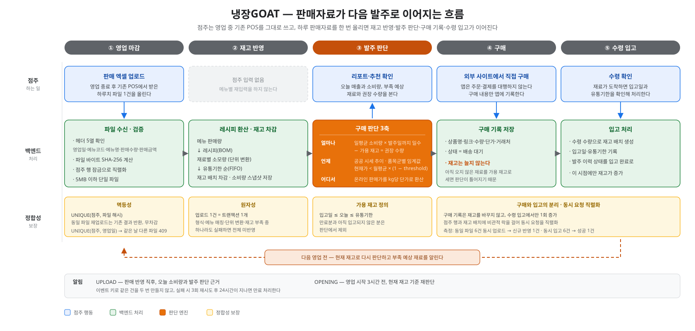

# 냉장GOAT (NaengjangGOAT)

> **기존 POS 판매자료와 공공 시세를 연결해 식당 점주의 재고 파악과 구매 시점·수량 판단을 지원하는 식자재 발주 지원 플랫폼**
>
> 감으로 하던 식자재 발주를, 데이터로.

[English README](README.en.md) · [Backend Repository](https://github.com/gm-15/naengjang-goat_backend)



## 프로젝트 개요

| 항목 | 내용 |
|---|---|
| 프로젝트 기간 | 2026.03.02 ~ 2026.10.16 |
| 과정 | 소프트웨어캡스톤디자인 |
| 팀 구성 | 3명 |
| 담당 | 백엔드 총괄 |
| 핵심 흐름 | POS 판매자료 → 재고 반영 → 가격 비교 → 발주 추천 → 구매 기록 → 수령 입고 |
| 테스트 | 75건 통과, 실패·오류 0건 (13개 테스트 클래스) |
| 현장 검증 | 2개 매장 결과물 공유 및 의견 수집 |

냉장GOAT는 점주가 기존 POS에서 내려받은 영업일 단위 판매 엑셀을 재고 데이터와 연결하고, 공공 시세와 온라인 판매 상품 가격을 함께 제공해 구매 판단을 돕습니다.

- **발주량과 부족 예상**은 판매량, 재고, 다음 발주일까지 남은 기간을 바탕으로 시스템이 계산해 추천합니다.
- **구매**는 점주가 외부 판매 사이트에서 직접 진행합니다.
- **구매 기록**과 **실제 수령 입고**를 분리해 관리합니다. 배송 대기 중인 상품은 재고에 포함하지 않습니다.
- 냉장GOAT는 **주문·결제를 대행하지 않습니다.** 온라인 상품 확인 후 외부 판매 사이트로 이동해 구매합니다.

## 문제 정의와 기획 배경

송탄점과 용인 막창점 점주 인터뷰에서 다음 운영 상황을 확인했습니다.

| 인터뷰에서 확인한 상황 | 운영상 문제 |
|---|---|
| 거래처 5곳에 SMS로 개별 발주 | 발주 업무가 여러 채널에 분산 |
| 재료 부족으로 월 3~6건 주문 취소 | 재고 부족과 발주 시점 누락 |
| 주당 3~5시간 재고 확인 | 냉장고를 직접 확인해야 하는 부담 |

이를 바탕으로 세 가지 문제를 정의했습니다.

1. **재고 파악의 부담**: 판매된 메뉴를 재료 사용량으로 환산하고 현재 재고를 파악하기 어렵습니다.
2. **가격 판단 근거 부족**: 품목마다 가격 변동 폭이 달라 단순 가격 비교나 전월 대비 등락만으로 구매 시점을 판단하기 어렵습니다.
3. **발주 시점을 놓침**: 고정 수량 기준만으로는 판매 속도와 다음 발주일까지 남은 기간을 반영하기 어렵습니다.

초기 B2C 아이디어에서 출발했으나, 점주 인터뷰를 통해 실제 매장의 업무 흐름을 반영하는 B2B 발주 판단 지원 서비스로 방향을 전환했습니다.

## 설계 전환

### 1. 락 데모에서 점주의 발주 판단 지원으로

초기 v0는 동시성 락 비교에 무게가 실린 구조였습니다. 그러나 기술적 정합성만으로 점주의 운영 문제를 해결했다고 볼 수 없었습니다. 점주가 필요로 하는 것은 락 자체가 아니라 재고 확인과 구매 판단 과정의 걱정과 수고를 줄이는 것이었습니다.

이후 기능의 중심을 재고·판매·레시피·가격·발주 판단으로 재정렬했습니다. 동시성 제어는 이 업무 흐름의 정합성을 지키는 기반으로 두었습니다.

### 2. 주문별 차감에서 영업일 단위 POS 업로드로

초기 설계는 주문이 발생할 때마다 재고를 차감하는 방식이었습니다. 인터뷰를 통해 점주는 영업 중 기존 POS를 사용하고 앱에 판매 건을 별도로 입력하지 않는다는 점을 확인했습니다.

이에 판매 입력 단위를 주문별 입력에서 **영업일 단위 POS 엑셀 업로드**로 변경했습니다. 정합성 보장 방식도 최종 POS 경로에 맞춰 다음과 같이 구성했습니다.

- 점주 행과 재고 배치에 대한 DB 비관적 락으로 동시 반영 직렬화
- 파일 바이트의 SHA-256 해시와 유일 제약으로 동일 파일 재업로드 차단
- 점주·영업일 유일 제약으로 같은 영업일의 다른 파일 중복 반영 차단
- 파싱, 메뉴 매칭, 단위 변환, 재고 검증 중 하나라도 실패하면 전체 미반영

초기 주문별 차감 구조에서 비교한 분산 락 전략은 주문 경로의 장애 대응 설계에 남기고, POS 일괄 반영에는 파일 단위 원자성과 멱등성을 적용했습니다.

## 점주의 하루

| 시점 | 점주의 상황 | 제공 기능 |
|---|---|---|
| 운영 전 | "오늘 양파가 모자라네." | 재고·유통기한 확인, 부족 재료 알림, 최저가 확인 |
| 운영 중 | "판매는 기존 POS로." | 재고·가격 조회, 수령 입고 |
| 운영 후 | "오늘 얼마 썼고 내일 뭘 살까?" | POS 엑셀 반영, 일일 운영 리포트, 가격 비교, 발주 추천 |

### 핵심 처리 흐름

1. 점주가 기존 POS에서 영업일 단위 판매 엑셀을 내려받습니다.
2. 파일을 업로드하면 메뉴별 판매량을 레시피에 연결합니다.
3. 메뉴 판매량과 레시피를 이용해 재료별 소비량을 계산하고 재고에 반영합니다.
4. 일일 운영 리포트에서 판매금액과 재료별 소비량을 확인합니다.
5. 온라인 판매 상품의 kg당 가격, 공공 시세, 재고 기반 발주 추천을 확인합니다.
6. 점주는 외부 판매 사이트에서 직접 구매한 뒤 구매 기록을 남깁니다.
7. 상품을 수령하면 입고 처리하고, 이때 실제 재고가 증가합니다.

## 구매 판단의 세 가지 축

세 기능은 서로 다른 데이터와 목적을 사용합니다.

| 판단 질문 | 기능 | 데이터와 기준 |
|---|---|---|
| 어디서 살 것인가? | 온라인 최저가 | 네이버 쇼핑·식자재왕 상품의 포장 중량을 kg당 단가로 환산해 비교 |
| 언제 살 것인가? | 공공 시세 buy-signal | KAMIS·EKAPE 시세 추이와 품목군별 변동계수 기반 임계값 |
| 얼마나 살 것인가? | 재고 기반 발주 추천 | 일평균 소비량 × 다음 발주일까지 기간 − 가용 재고 |

### 온라인 가격 비교

상품마다 포장 중량과 표시 가격이 달라 원래 가격만으로는 직접 비교하기 어렵습니다. MySQL `GENERATED ALWAYS AS ... STORED` 컬럼을 사용해 kg당 단가를 계산·저장하고, 해당 값에 인덱스를 적용해 정렬에 활용합니다.

```sql
unit_price_per_kg =
    price * 1000 / weight_grams
```

원본 가격이나 중량이 변경되면 생성 컬럼 값도 DB에서 함께 갱신됩니다.

### 공공 시세와 buy-signal

KAMIS와 EKAPE에서 수집한 공공 시세는 온라인 판매 상품 가격과 별도 데이터로 관리합니다. 공공 시세는 시장 가격의 흐름과 구매 시점 판단에 활용하고, 온라인 가격은 실제 구매 후보 간 단가 비교에 활용합니다.

단순 전월 대비 등락률은 두 시점 사이의 변화량을 나타내지만, 그 변화가 해당 품목에서 평소보다 큰 움직임인지는 설명하지 못합니다. 이를 보완하기 위해 2019~2024년 6년 가격 데이터를 분석해 품목군별 변동계수(CV)를 기준으로 임계값을 설정했습니다.

CV는 가격이 평소 얼마나 흩어져 있는지를 나타내는 지표입니다. 품목군마다 평소 가격 변동 폭이 다르므로 동일한 임계값 대신 품목군별 기준을 사용합니다.

| 품목군 | 분석 데이터 및 평균 변동 폭 | buy-signal 임계값 |
|---|---|:---:|
| 채소 | 배추 16.1%, 양파 5.0%, 무 16.8%, 파 28.4% → 평균 16.6% | **0.17** |
| 축산 | EKAPE 소비자가격 4품목 평균 4.9% | **0.08** |
| 수산 | 고등어 7.7%, 명태 5.6% → 평균 6.7% | **0.07** |
| 과일 | 배 12.3%, 사과 후지 12.9% → 평균 12.6% | **0.13** |
| 곡물 | 쌀 4.5% | **0.05** |
| 가공 | 변동성이 낮아 고정 기준 적용 | **0.03** |

이상치는 z-score ≤ 1.3 기준으로 제거한 데이터에서 변동 폭을 분석했습니다. 축산은 KAMIS의 데이터 범위 한계로 EKAPE 소비자가격 데이터를 별도로 분석했습니다.

buy-signal 판정식은 다음과 같습니다.

```text
currentPricePerKg < monthAvg × (1 - threshold)
```

### 재고 기반 발주 추천

고정 재고 임계값 대신 현재 재고가 다음 발주일까지 유지될 수 있는지를 판단합니다.

```text
추천 발주량 = 일평균 소비량 × 다음 발주일까지 남은 일수 - 가용 재고
```

가용 재고는 입고 배치의 입고일과 유통기한을 고려해 산정합니다. 판매량, 재고량, 발주 요일에 따라 일평균 소모량, 재고 등급, 소진 예정일, 발주 알림을 계산합니다.

## 기술적 문제 해결과 검증

### 1. 초기 설계 검증: 4종 락 비교

주문별 재고 차감 구조에서 Lost Update가 발생할 수 있음을 확인했습니다. MySQL `REPEATABLE READ` 환경에서 초기 재고 100g에 요청당 1g을 차감하는 500스레드 실험을 수행했습니다. 락이 없을 때 요청이 모두 성공했음에도 최종 재고가 10g 남았습니다.

아래 결과는 **초기 주문별 차감 구조를 대상으로 한 락 전략 검증이며, 최종 POS 업로드 구현의 부하 테스트 결과가 아닙니다.**

| 방식 | 최종 재고 | 결과 | 설정 및 역할 |
|---|:---:|:---:|---|
| NONE | 10g 잔존 | 정합성 깨짐 | Lost Update 재현, 회귀 기준선으로 보존 |
| SPIN (Redis SETNX) | 0g | 정상 | TTL 30초, polling 1ms |
| REDISSON + CB | 0g | 정상 | `tryLock(5s wait, 10s lease)`, 기본 전략 |
| PESSIMISTIC | 0g | 정상 | Redis 장애 시 Circuit Breaker를 거쳐 전환 |

세 가지 락 방식 모두 해당 실험에서 정합성을 지켰으므로, 선택 기준은 락을 기다리는 동안의 동작과 분산 환경에서의 운영 방식으로 정했습니다.

- **Spin Lock**은 락 획득에 실패하면 Redis에 반복 요청합니다. 대기 시간이 길어질수록 재시도 부하가 커지며, 작업이 TTL을 넘긴 상황에서는 다른 요청이 획득한 락을 잘못 해제할 위험이 있습니다.
- **Redisson**은 락 해제 알림을 기다리는 방식이며, 락 보유자일 때만 해제합니다. 서버가 여러 대로 늘어나는 환경을 고려해 기본 전략으로 선택했습니다.
- **Circuit Breaker**는 Redis 연속 실패 시 DB 비관적 락으로 전환하도록 구성했습니다.

`docker stop redis-test`를 이용한 Chaos Test에서 Redis 장애 후 PESSIMISTIC 경로로 전환되는 것을 확인했습니다.

### 2. 최종 구현 검증: POS 일괄 반영

POS 업로드는 파일 단위로 원자성과 멱등성을 보장하도록 구현했습니다.

| 검증 항목 | 검증 조건 | 결과 |
|---|---|---|
| 동일 파일 동시 업로드 | 동일 파일 6건 동시 요청 | 신규 반영 1건, 재고 6,000g → 2,000g 한 번만 차감, 알림 1건 |
| 동일 파일 재업로드 | 파일 바이트 SHA-256 및 `UNIQUE(user_id, file_hash)` | 동일 파일 재반영 방지 |
| 동일 영업일 다른 파일 | `UNIQUE(user_id, business_date)` | 중복 업로드 요청 409 |
| 동시 수령 입고 | 동일 입고 6건 동시 요청 | 성공 1건, 나머지 409, 재고 2,000g → 4,000g |
| 부분 실패 방지 | 형식 오류, 메뉴 매칭 실패, 단위 변환 실패, 재고 부족 | 하나라도 실패하면 전체 미반영 |

최종 POS 및 입고 경로는 분산 락이 아니라 **점주 행과 재고 배치에 대한 DB 비관적 락**으로 직렬화합니다.

### 3. 최종 구현 검증: 발주 판정 회귀 테스트 11건

판매량·재고·발주 요일을 달리한 11개 케이스로 다음 항목을 검증했습니다.

- 일평균 소모량
- 재고 등급
- 소진 예정일
- 발주 알림

동일한 판매량과 재고에서 다음 발주일까지 남은 기간만 3일에서 6일로 바꾸자 재고 등급이 `충분`에서 `보통`으로 변경되는 것을 확인했습니다.

판정식이 발주일까지의 거리를 실제로 반영하는지 역검증도 수행했습니다.

- 등급 경계를 0.60에서 0.50으로 변경했을 때 해당 경계 테스트 1건 실패
- 발주일 거리를 판정식에서 제거했을 때 11건 중 8건 실패

### 4. 가격 데이터 정합성

가격 데이터 파이프라인에서 관측일, 단위 환산(kg 이중 환산), 등급별 중복 적재 오류를 수정했습니다.

| 정합성 기준 | 적용 |
|---|---|
| 가격 출처 | `source` |
| 가격 기준 | `price_basis` (도매·소매 등) |
| 관측일 | `reported_date` |
| 관측 식별자 | `observation_key` |
| 중복 방지 | `UNIQUE(ingredient_id, source, price_basis, reported_date, observation_key)` |

동일 배치를 2회 실행했을 때 저장 행은 20건으로 유지됐고, 중복 조합은 0건이었습니다.

### 5. 전체 테스트 결과

| 항목 | 결과 |
|---|:---:|
| 테스트 클래스 | 13개 |
| 전체 테스트 | 75건 통과 |
| 실패·오류 | 0건 |

## 아키텍처

### 데이터 수집 및 처리 구조

```text
                    [Public Market Price]
                    KAMIS (농산물 도매 XML)
                    EKAPE (축산 공공데이터 API)
                               |
                               v
                     [Spring Batch]
                     kamisPriceStep
                       chunk = 50
                               |
                               v
                         market_price
                         원/kg 정규화
                               |
                               +----------------------+
                                                      |
                                                      v
[Online Product Price]                         [Buy Signal]
Naver Shopping API (JSON)                      buySignalNotifyStep
식자재왕 크롤링 (Selenium)                      (Tasklet)
          |                                           |
          v                                           v
   kg당 단가 정규화                             품목군별 임계값 판정
   GENERATED COLUMN
          |
          v
    price_records

[POS Excel]
     |
     v
파일 검증 · SHA-256 멱등성
     |
     v
메뉴 매칭 · 레시피 환산
     |
     v
점주 행 + 재고 배치 비관적 락
     |
     v
단일 트랜잭션 재고 반영
     |
     v
일일 운영 리포트 · 발주 추천
```

### 가격 데이터 저장소 분리

| 데이터 소스 | 수집 방식 | 저장 테이블 | 저장 기준 |
|---|---|---|---|
| KAMIS | 공공 API, XML | `market_price` | 원/kg으로 정규화한 공공 도매 시세 |
| EKAPE | 공공데이터포털 API, XML | `market_price` | 원/kg으로 정규화한 축산 공공 시세 |
| Naver Shopping | API, JSON | `price_records` | 온라인 상품 가격과 포장 중량, 생성 컬럼 단가 |
| 식자재왕 | Selenium 크롤링 | `price_records` | 온라인 상품 가격과 포장 중량, 생성 컬럼 단가 |

공공 시세는 Spring Batch로 주기 수집해 DB에 적재합니다. 온라인 판매가는 화면 조회 시점에 외부 API 등을 호출하며 30분 캐시를 적용합니다.

### 배치 및 동시성 경로

```text
Spring Batch
  kamisPriceStep (chunk = 50)
       |
       v
  buySignalNotifyStep (Tasklet)

주문 경로
  Redisson Distributed Lock
       |
       v
  Circuit Breaker
       |
       v
  Pessimistic Lock (DB fallback)

POS 업로드 / 수령 입고 경로
  점주 행 잠금
       +
  재고 배치 비관적 락
       |
       v
  단일 트랜잭션
```

### 알림

| 알림 | 생성 시점 | 내용 |
|---|---|---|
| UPLOAD | 판매 반영 직후 | 오늘 소비량과 발주 판단 근거 |
| OPENING | 영업 시작 3시간 전 | 현재 재고 기준 재판단 결과 |

이벤트 키로 같은 건을 두 번 만들지 않으며, 실패 시 3회까지 재시도하고 생성 후 24시간이 지나면 만료 처리합니다.

## 구현 기능

- [x] JWT 로그인 및 점주별 데이터 소유권 검증
- [x] 입고 배치 등록 및 유통기한·입고일 기반 가용 재고 산정
- [x] POS 엑셀 업로드 및 레시피 기반 재료 소비량 환산
- [x] 파일 해시 멱등성 및 영업일 중복 업로드 차단
- [x] 일일 운영 리포트 및 재료별 소비량 조회
- [x] 일평균 소비량·다음 발주일까지 기간 기반 발주 추천
- [x] KAMIS·EKAPE 공공 시세 수집 및 추이 조회
- [x] 품목군별 buy-signal 판정
- [x] Naver Shopping·식자재왕 온라인 상품 가격 비교
- [x] kg당 단가 환산 및 정렬
- [x] 구매 기록과 실제 수령 입고 분리
- [x] 알림 레코드 생성 및 발송 파이프라인
- [x] 알림 중복 차단, 재시도 3회, 24시간 만료
- [x] 판매 반영 후 알림 및 영업 시작 3시간 전 알림 생성
- [x] 발주 이력 CRUD 및 Excel Export
- [x] Flyway V001~V011 스키마 마이그레이션

## 현장 검증

구현 결과물을 두 매장에 공유하고 점주 의견을 수집했습니다.

| 검증 항목 | 삼산회관 소래포구점 | 대구반야월막창 |
|---|:---:|:---:|
| 재고·발주 계산 참고도 | 4점 | 5점 |
| 출시 시 사용 의향 | 5점 | 5점 |
| 주 사용 기기 | 휴대폰 | 휴대폰 |

- 재고·발주 계산 참고도는 평균 **4.5점**이었습니다.
- 리포트에서 우선 확인하고 싶은 항목은 판매금액이었습니다.
- 점주 의견: "단점이 아직 안 보인다", "확실한 실시간 노출과 알림이 있다면 충분히 사용해볼 가치가 있다."
- 두 매장 모두 고정 거래처 없이 마트에서 채소를 구매했으며, 요일과 날씨에 따른 가격 변동을 주요 불편으로 언급했습니다.
- 추가 요청은 카카오톡 알림, 앱 내 결제, 발주 내역에 당시 시세 기록이었습니다.

> 현장 의견 수집 대상은 2개 매장이며, 결과를 전체 외식업 매장의 통계로 일반화하지 않습니다.

## 기술 스택

| 영역 | 기술 |
|---|---|
| Language | Java 21 |
| Backend | Spring Boot 3.5.7, Spring Batch, Spring Security, Spring Data JPA |
| Database | MySQL 8.0+, GENERATED COLUMN STORED |
| Migration | Flyway V001~V011 |
| Cache / Lock | Redis 7, Redisson 3.23.2 |
| Fault Tolerance | Resilience4j 2.1.0 |
| Notification | Firebase Cloud Messaging (FCM) |
| Test | JUnit 5, CountDownLatch |
| Public Data | KAMIS (XML), EKAPE 공공데이터포털 (XML) |
| Online Price | Naver Shopping (JSON), 식자재왕 크롤링 |
| Web | Vite 6.3, TypeScript 5.9, React (73개 화면) |
| Mobile | React Native 0.86, Expo 57, expo-router (26개 화면) |
| Crawler | Python 3, Selenium |

## 팀 구성 및 담당

| 박건우 · Backend Lead | 심상묵 · Data | 김건우 · Frontend |
|---|---|---|
| 도메인 설계 및 서비스 방향 전환 | EKAPE 공공데이터 API 전환 | 웹 화면 구현 |
| 4종 락 비교 및 Redisson·Circuit Breaker·비관적 락 폴백 | KAMIS 호출 수정 | 모바일 화면 구현 |
| POS 업로드 원자성·멱등성·직렬화 | 식자재왕 크롤러 | 웹·모바일 UI |
| 가격 모듈, 6년 임계값 분석, GENERATED COLUMN, 관측 정합성 | 레시피 템플릿 | |
| 구매·입고 분리 | | |
| FCM 인프라 및 마감·영업 전 알림 | | |

## 로컬 실행

> **Redis를 먼저 실행해야 합니다.** `RedissonClient` 빈을 애플리케이션 기동 시점에 생성하므로 Redis가 실행되지 않으면 Flyway 마이그레이션 이후 Spring 컨텍스트 생성 단계에서 실패합니다.

### 1. Redis 실행

```bash
docker run -d --name redis-test -p 6379:6379 redis:7-alpine
docker exec redis-test redis-cli ping
```

정상 응답은 `PONG`입니다.

### 2. MySQL 데이터베이스 생성

```bash
mysql -u root -p -e "CREATE DATABASE naengjang_goat_db CHARACTER SET utf8mb4 COLLATE utf8mb4_unicode_ci;"
```

### 3. 환경변수 설정

```bash
export DB_URL="jdbc:mysql://localhost:3306/naengjang_goat_db"
export DB_PASSWORD="your-db-password"
export KAMIS_API_KEY="your-kamis-api-key"
export EKAPE_API_KEY="your-ekape-api-key"
```

- `EKAPE_API_KEY`가 설정되지 않으면 축산 시세 수집 단계만 건너뜁니다.
- 인증키와 DB 비밀번호는 저장소에 커밋하지 말고 환경변수로 전달합니다.

### 4. 애플리케이션 실행

```bash
./gradlew bootRun
```

Flyway가 V001~V011을 순서대로 적용한 뒤 애플리케이션이 기동합니다.

### 데모 데이터 구성

`demo` 프로필로 실행한 뒤 데모 초기화 API를 호출합니다.

```bash
export SPRING_PROFILES_ACTIVE=demo
./gradlew bootRun

curl -X POST http://localhost:8080/demo/setup
```

| 항목 | 값 |
|---|---|
| 데모 계정 | `demo` |
| 데모 비밀번호 | `demo1234` |

데모 시나리오의 전체 절차와 기대 수치는 [DEMO RUNBOOK](docs/handoff/DEMO_RUNBOOK.md)에 정리했습니다.

### 테스트 DB 주의사항

테스트는 `TEST_DB_URL`로 별도 데이터베이스를 지정합니다. 일부 테스트는 테이블 데이터를 비우므로 운영 또는 개인 데이터가 있는 DB를 테스트 대상으로 지정하지 마세요.

```bash
export TEST_DB_URL="jdbc:mysql://localhost:3306/naengjang_goat_test"
./gradlew test
```

## 다음 단계

- 카카오톡 알림
- 앱 내 결제
- 판매 취소와 재고 복구
- POS사별 양식 매핑
- 실시간 POS 연동

## 참고 문서

| 문서 | 설명 |
|---|---|
| [RUNBOOK](docs/integration/RUNBOOK.md) | 통합 및 운영 참고 |
| [DEMO RUNBOOK](docs/handoff/DEMO_RUNBOOK.md) | 데모 실행 절차 |
| [API CONTRACT](docs/handoff/API_CONTRACT.md) | API 계약 |
| [KAMIS PRICE FIX](docs/integration/KAMIS_PRICE_FIX.md) | KAMIS 가격 데이터 수정 기록 |
| [CSV PRICE SEED](docs/integration/CSV_PRICE_SEED.md) | 시세 CSV 적재 절차 |
| [Flyway Migrations](src/main/resources/db/migration/) | DB 스키마 마이그레이션 |
| [README.en.md](README.en.md) | English README |
| [README_0315.md](README_0315.md) | 초기 README |

## 연락처

**박건우** · Backend Engineer

- Email: <gunwoo363@gmail.com>
- GitHub: [github.com/gm-15](https://github.com/gm-15)
- Blog: [velog.io/@gm-15](https://velog.io/@gm-15)
