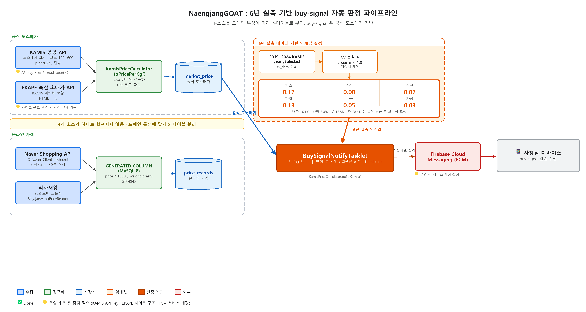

# 냉장GOAT — 식자재 발주 지원 플랫폼

기존 POS 판매자료와 공공 시세를 연결해 식당 점주의 **재고 파악 · 구매 시점 · 구매 수량** 판단을 지원하는 Spring Boot 3.5 / Java 21 백엔드.

**이 서비스가 하는 일과 하지 않는 일**

- 발주량과 부족 예상은 시스템이 계산해 **추천**한다
- 구매는 점주가 외부 판매 사이트에서 **직접** 진행한다
- 구매 기록과 실제 수령 입고는 **분리**해 관리한다
- 주문·결제를 대행하지 않는다. 자동 재고 인식이 아니라 **판매자료 기반 재고 추정**이다

**구성:** 저장소 루트는 Spring 백엔드, `frontend/`는 웹, `mobile/`은 React Native 앱입니다.

**실행·시연:** [통합 서비스 실행 안내](docs/integration/RUNBOOK.md) · [시연 런북](docs/handoff/DEMO_RUNBOOK.md) · [API 계약](docs/handoff/API_CONTRACT.md)

**데이터 검증:** [KAMIS 관측일·도매/소매·중복 적재 수정](docs/integration/KAMIS_PRICE_FIX.md) · [시세 CSV 시드 절차](docs/integration/CSV_PRICE_SEED.md)

🇬🇧 [README.en.md](README.en.md) · 📜 v1 보존본: [README_0315.md](README_0315.md)

---

## 프로젝트 요약

| 항목 | 내용 |
|---|---|
| 기간 | 2026.03.02 ~ 2026.10.16 (소프트웨어캡스톤디자인, 3인 팀) |
| 역할 | 백엔드 총괄 박건우 · 데이터 심상묵 · 프론트 김건우 |
| 스택 | Spring Boot 3.5.7 · Java 21 · MySQL 8 · Redis 7 · Spring Batch · Flyway · Resilience4j · FCM |
| 핵심 흐름 | POS 판매자료 → 재고 반영 → 가격 비교 → 발주 추천 → 구매 기록 → 수령 입고 |
| 검증 | 전체 테스트 **75건 통과 / 실패·오류 0** (13개 클래스) |
| 현장 검증 | 2개 매장, 재고·발주 계산 참고도 평균 4.5점, 출시 시 사용 의향 각각 5점 |
| 최종 상태 | 2026-11-11 main 머지 기준. **배포된 운영 서버 없음 — 로컬 데모 환경** |
| 졸업작품 | 심사 통과 |



---

## 배경

식자재 B2B 시장은 KFDA 추정 2023년 62조 원 규모로 연 평균 약 4.7% 성장 중이다.
그러나 송탄점·용인 막창점 사장님 인터뷰 결과, 여전히 거래처 5곳에 SMS로 개별 발주, 월 3~6건 재료 부족으로 인한 주문 취소, 주당 3~5시간을 재고 확인에 소비하고 있었다.

현장에서 확인한 세 가지 문제:

1. **재고 파악의 부담** — 냉장고를 직접 확인, 실시간 파악 불가
2. **가격 판단 근거 부족** — 지금 가격이 싼지 비교할 수단 없음
3. **발주 시점을 놓침** — 재고 소진 시점을 인지하지 못해 발주가 늦어짐

발주고·식자재왕·오늘얼마 등 기존 앱은 각자 강점이 있으나, 재고 추정 + 발주 타이밍 + 시장 평균가 비교 세 가지를 동시에 제공하는 서비스는 없었다.

---

## v0 → v2 피봇 — "엔진은 람보르기니인데 운전석이 없다"

v0은 동시성 락 전략 데모였다. 2026-04-05 plan.md에서 자기 비판이 들어갔다.

> *사장님은 데이터 정합성이 아니라 걱정과 수고를 덜어주는 대가로 월 3만원을 낸다.*

이후 모든 기능은 **발주 판단 지원** 하나에 정렬됐다.

두 번째 전환은 입력 단위였다. 초기 설계는 주문이 들어올 때마다 재고를 차감하는 구조였으나, 점주 인터뷰에서 영업 중에는 기존 POS를 쓰고 앱에 건별 입력을 하지 않는다는 점을 확인하고 **영업일 단위 엑셀 업로드**로 바꿨다. 정합성을 지키는 방식도 분산 락에서 점주 단위 DB 잠금 + 파일 해시 멱등성 + 단일 트랜잭션으로 함께 옮겼다.

---

## 점주의 하루 — 운영 전 · 중 · 후

| 시점 | 점주 상황 | 제공 기능 |
|---|---|---|
| 운영 전 | "오늘 양파가 모자라네." | 현재 재고·유통기한 확인, 부족 재료 알림, 최저가 |
| 운영 중 | "판매는 평소처럼, 기존 POS로." | 재고·가격 조회, 배송받은 재료 수령 입고 |
| 운영 후 | "오늘 얼마나 썼고, 내일 무엇을 살까?" | POS 엑셀 반영 → 소비량·잔여 재고, 일일 리포트, 가격 비교, 발주 추천 |

운영 중에 앱으로 판매를 중복 입력하지 않는 것이 설계 의도다.

---

## 구매 판단 3축

세 축은 **서로 다른 데이터와 판단 기준**을 쓴다. 하나의 가격 추천 알고리즘이 아니다.

| 질문 | 수단 | 근거 데이터 | 상태 |
|---|---|---|:---:|
| 어디서 살 것인가 | 온라인 최저가 | 네이버 쇼핑 등 상품을 kg당 단가로 환산해 비교 | ✅ |
| 언제 살 것인가 | 공공 시세 buy-signal | KAMIS·EKAPE 가격 추이, 품목군별 변동계수 기반 | ✅ |
| 얼마나 살 것인가 | 재고 기반 발주 추천 | 일평균 소비량 × 다음 발주일까지 기간 − 가용 재고 | ✅ |

실제 점주의 시간 절감 효과는 별도 사용자 검증 대상이며 구현 완료와 구분한다.

---

## 핵심 측정 결과

### [초기 설계 검증] 4종 락 비교 — 500-스레드, 초기 재고 100g, 1g/요청

주문이 들어올 때마다 재고를 차감하던 **초기 구조**를 대상으로 한 실험이다. 최종 구현의 부하 테스트가 아니다.

| 전략 | 잔여 재고 | 정합성 | 비고 |
|---|:---:|:---:|---|
| NONE (control) | **10g** | ❌ | Lost Update fingerprint — 회귀 ground truth로 의도적 보존 |
| SPIN (Redis SETNX) | 0g | ✅ | TTL 30s, polling 1ms |
| REDISSON + CB | 0g | ✅ | tryLock(5s wait, 10s lease), **1순위** |
| PESSIMISTIC | 0g | ✅ | REDISSON 장애 시 CB 자동 fallback |

세 방식 모두 정합성은 지켜졌으므로 선택 기준은 **대기할 때의 동작**으로 잡았다.
스핀락은 락을 못 잡으면 Redis에 계속 재시도해 대기가 길어질수록 부하가 커지고, 작업이 TTL을 넘기면 다른 요청이 잡은 락을 지울 수 있다. Redisson은 해제 알림을 기다리고 보유자일 때만 락을 푼다.

NONE 잔여 10g은 MySQL REPEATABLE READ의 Last-Writer-Wins 실측 fingerprint다.
"항상 통과하는 테스트는 ground truth를 잃은 테스트"라는 판단으로 NONE을 코드베이스에 보존했다.

ChaosTest (`docker stop redis-test`): CB (slidingWindow=10, failureRate=50%) 연속 실패 후 PESSIMISTIC 자동 전환 확인.

### [최종 구현 검증] POS 일괄 반영 · 구매와 입고 분리

| 검증 | 결과 |
|---|---|
| 동일 파일 6건 동시 업로드 | 신규 반영 **1건**, 재고 6,000g → 2,000g **1회만 차감**, 알림 1건 |
| 동시 수령 입고 6건 | 성공 **1건** (나머지 409), 재고 2,000g → 4,000g |
| 오류 시 동작 | 형식·메뉴 매칭·단위 변환·재고 부족 중 하나라도 실패하면 **전체 미반영** |

업로드 경로는 분산 락이 아니라 **점주 행과 재고 배치에 대한 비관적 락**으로 직렬화한다.
파일 바이트 SHA-256 + `UNIQUE(user_id, file_hash)`로 동일 파일 재업로드를 무반영 처리하고, `UNIQUE(user_id, business_date)`로 같은 영업일의 다른 파일을 409로 거절한다.

### [최종 구현 검증] 발주 판정 회귀 테스트 11건

판매량·재고량·발주 요일을 달리해 일평균 소모량, 재고 등급, 소진 예정일, 발주 알림을 단정한다.

- 동일 판매량·재고에서 발주일까지 기간만 3일 → 6일로 바꾸면 등급이 충분 → 보통으로 변경
- 역검증: 등급 경계를 0.60 → 0.50으로 바꾸면 해당 경계 1건 실패, 발주일 거리를 판정식에서 제거하면 11건 중 8건 실패

### KAMIS 6년 buy-signal threshold (2019~2024, z-score ≤ 1.3 이상치 제거)

| 카테고리 | 분석 품목 및 CV | Threshold |
|---|---|:---:|
| 채소 | 배추 16.1% · 양파 5.0% · 무 16.8% · 파 28.4% → avg 16.6% | **0.17** |
| 축산 | EKAPE 소비자가격 4품목 avg 4.9% (삼겹살 8.3%) | **0.08** |
| 수산 | 고등어 7.7% · 명태 5.6% → avg 6.7% | **0.07** |
| 과일 | 배 12.3% · 사과후지 12.9% → avg 12.6% | **0.13** |
| 곡물 | 쌀 4.5% | **0.05** |
| 가공 | 변동 낮음, 별도 분석 없이 고정 | **0.03** |

buy-signal 조건: `currentPricePerKg < monthAvg × (1 − threshold)`

CV는 가격이 평소 얼마나 흩어져 있는지를 나타내는 산포도 지표다. 단순 전월 대비 등락은 그 변화가 해당 품목 기준으로 특이한 일인지 말해주지 않기 때문에, 품목군별 변동폭을 임계값의 기준자로 삼았다.

> **축산 0.08은 측정 평균에서 도출한 값이 아니다.** 최초 설계 시 업계 참고값으로 고정했고, EKAPE 실측(4품목 평균 4.9%) 이후에도 B2B 도매가 변동이 더 클 것으로 보아 유지했다. 측정 품목 중 변동이 가장 큰 삼겹살(8.3%)과 거의 일치한다.

### 가격 데이터 정합성

- 저장 시세의 관측일, 단위 환산(kg 이중 환산), 등급별 중복 적재 오류 3건 수정
- 가격 기준(도매/소매)·관측일·관측 식별자를 스키마에 명시하고 `UNIQUE(ingredient_id, source, price_basis, reported_date, observation_key)` 적용
- 같은 배치를 연속 2회 실행해도 저장 20행 유지, 중복 조합 0건 (2026-10-19 로컬 확인)
- 기존 행은 채널·관측일을 복원할 수 없어 추측 변환 없이 `LEGACY`로 보존

---

## 아키텍처

```
[4-소스 가격 수집 + 2-테이블 분리]
  KAMIS  (농산물 도매 XML)   ─┐
  EKAPE  (축산 공공데이터 API) ─┴─▶ market_price   ← Java 런타임 정규화 (원/kg)
                                    + price_basis · observation_key 유일 인덱스

  Naver Shopping API        ─┐
  식자재왕 B2B 크롤링         ─┴─▶ price_records  ← GENERATED ALWAYS AS (price×1000/weight_grams) STORED

[Spring Batch 파이프라인]
  kamisPriceStep (chunk=50)
    KamisApiReader → KamisPriceProcessor → KamisPriceWriter
        ↓
  buySignalNotifyStep (tasklet)
    BuySignalNotifyTasklet → 사용자별 집계 → FCM 알림

[동시성 제어]
  주문 경로     : REDISSON ──▶ CircuitBreaker ──▶ PESSIMISTIC (fallback)
  POS·입고 경로 : 점주 행 + 재고 배치 비관적 락으로 직렬화
```

공공 시세는 Spring Batch로 주기 수집해 적재하고, 온라인 판매가는 **화면 조회 시점에 호출**해 30분간 캐시한다.

---

## 구현 완료

- ✅ POS 일괄 반영 — 영업일 단위 엑셀 → 레시피 환산 → 재고 차감. 해시 멱등성·단일 트랜잭션·점주 단위 직렬화
- ✅ 발주 판단 — 일평균 소비량·가용 재고·발주 주기 기반 추천 수량과 소진 예정일, 회귀 테스트 11건
- ✅ 동시성 제어 — 4종 락 비교 + Circuit Breaker fallback
- ✅ 가격 통합 — 4-소스 · 2-테이블 분리 · GENERATED COLUMN 단위 정규화 · 관측 식별자 유일 인덱스
- ✅ buy-signal — 6년 실측 threshold · 품목군별 차등 판정
- ✅ 구매 기록 · 수령 입고 분리 — 구매 시 재고 불변, 수령 시에만 배치 생성
- ✅ 알림 — UPLOAD(판매 반영 후) · OPENING(영업 시작 3시간 전) 생성, 중복 차단, 재시도 3회·24시간 만료
- ✅ 발주 이력 — CRUD + Excel export
- ✅ 인증 — JWT (Access 1h / Refresh 7d) · Spring Security · 점주별 소유권 검증
- ✅ 스키마 — Flyway V001~V011, 빈 DB에서 전체 적용 확인

---

## 미구현

| 항목 | 상태 |
|---|---|
| 카카오톡 알림 | 미착수. 설문에서 두 매장 모두 1순위로 요청 |
| 앱 내 결제 | 미착수. 현재는 외부 판매 사이트로 이동 |
| 판매 취소 · 재고 복구 | `OrderStatus.CANCELED` enum만 존재, 구현은 별도 브랜치 |
| 재고 실사 보정 | `inventoryDay` 설정만 있고 보정 기능 없음. 폐기·서비스 제공분은 반영 경로가 없어 장부와 실물이 벌어진다 |
| 만료 재고 자동 폐기 | 가용 재고에서 제외하되 목록에는 남는다 |
| POS사별 양식 매핑 | 헤더 5개 고정(`영업일·메뉴코드·메뉴명·판매수량·판매금액`) |
| 실시간 POS 연동 | 영업일 단위 파일 업로드로 대체 |

---

## 현장 검증

구현 후 두 매장에 결과물을 공유하고 추가 의견을 확인했다 (2026-10월 말).

**삼산회관 소래포구점 · 대구반야월막창**

| 항목 | 결과 |
|---|---|
| 재고·발주 계산 참고도 | 4점 · 5점 (평균 4.5) |
| 출시 시 사용 의향 | 양쪽 5점 |
| 사용 기기 | 양쪽 휴대폰 |
| 리포트 우선 항목 | 판매금액 / 부족 예상 재료 |

> "단점이 아직 안 보인다" · "확실한 실시간 노출과 알림이 있다면 충분히 사용해볼 가치가 있다"

**초기 요구사항과 달랐던 점.** 두 곳 모두 고정 거래처 없이 마트에서 채소를 구매하고, 요일과 날씨에 따른 가격 변동을 가장 큰 불편으로 꼽았다. 초기 인터뷰에서 확인한 "거래처 다섯 곳에 문자로 따로 발주"와는 다른 운영 방식이다.

**추가 요청:** 카카오톡 알림(양쪽 1순위) · 앱 내 결제 · 발주 내역에 당시 시세 기록

> **n=2 사례다. 통계로 일반화하지 않는다.**

---

## 최종 상태와 한계

- 2026-11-11 main 머지 기준. **배포된 운영 서버는 없고 로컬 데모 환경에서 동작을 확인했다.**
- 졸업작품 심사 통과. 심사 의견: **레시피 기반 소진량 추정에는 정밀도 한계가 있어 결국 점주의 관리가 필요하다.**
- 이는 약점이자 설계 전제다. 시스템이 실제 재고를 완벽히 인식한다고 주장하지 않는다. 판매자료와 레시피로 소진량을 **추정**하고, 점주가 입고·재고를 관리할 수 있게 돕는 구조다.
- 1인분 소모량(BOM)은 점주 입력값이다. 템플릿 기본값은 검증된 레시피가 아니다.
- 시연용 과거 시세는 로컬 DB에만 적재했다. 저장소를 받는 것만으로 생기지 않는다 ([적재 절차](docs/integration/CSV_PRICE_SEED.md)).
- **측정하지 않은 값:** 처리량(TPS), API 응답 시간, 발주 시간 절감, 품절·폐기 감소, 비용 절감, 실사용자 수.

---

## 기술 스택

| 영역 | 기술 |
|---|---|
| 언어 | Java 21 |
| 프레임워크 | Spring Boot 3.5.7 · Spring Batch · Spring Security · Spring Data JPA |
| DB | MySQL 8.0+ (GENERATED COLUMN STORED) |
| 마이그레이션 | Flyway V001~V011 |
| 캐시 · 분산 락 | Redis 7 · Redisson 3.23.2 |
| 신뢰성 | Resilience4j 2.1.0 (CircuitBreaker) |
| 알림 | Firebase Cloud Messaging (FCM) |
| 테스트 | JUnit 5 · CountDownLatch · Testcontainers 미사용(로컬 Redis 컨테이너) |
| 외부 API | KAMIS (XML) · EKAPE 공공데이터포털 (XML) · Naver Shopping (JSON) |
| 웹 (`frontend/`) | Vite 6.3 · TypeScript 5.9 · React — 73개 화면 컴포넌트 |
| 모바일 (`mobile/`) | React Native 0.86 · Expo 57 · expo-router — 26개 화면 컴포넌트 |
| 크롤러 (`crawler/`) | Python 3 · Selenium |

---

## 역할 및 담당

| 영역 | 박건우 | 심상묵 | 김건우 |
|---|---|---|---|
| 도메인 설계 | 발주 판단 기준 정의 · 피봇 결정 | | |
| 동시성 | 4종 락 + CB 구현 · 500-스레드 테스트 | | |
| POS 반영 | 업로드 원자성·멱등성·직렬화 | | |
| 가격 통합 | `pricing/` 모듈 · 6년 threshold · GENERATED COLUMN · 관측 정합성 | EKAPE 공공데이터 API 전환 · KAMIS 호출 수정 | |
| 구매·입고 | 구매 기록과 수령 입고 분리 | | |
| 알림 | FCM 인프라 · 마감/영업 전 알림 | | |
| 외부 크롤러 | | 식자재왕 크롤러 · 레시피 템플릿 | |
| 클라이언트 | | | 웹·모바일 화면 |

---

## 로컬 실행

> **Redis를 먼저 띄워야 한다.** `RedissonClient` 빈을 기동 시점에 생성하므로, Redis가 없으면 Flyway 마이그레이션까지 끝난 뒤 컨텍스트 생성이 실패한다.

```bash
# 1. Redis
docker run -d --name redis-test -p 6379:6379 redis:7-alpine
docker exec redis-test redis-cli ping   # PONG 확인 후 다음 단계

# 2. MySQL 스키마 생성
mysql -u root -p -e "CREATE DATABASE naengjang_goat_db CHARACTER SET utf8mb4 COLLATE utf8mb4_unicode_ci;"

# 3. 환경변수 (application.properties 기본값 참조)
export DB_URL=jdbc:mysql://localhost:3306/naengjang_goat_db
export DB_PASSWORD=<your-password>
export KAMIS_API_KEY=<your-key>
export EKAPE_API_KEY=<your-key>      # 미설정 시 축산 수집만 건너뛴다

# 4. 실행 (Flyway V001~V011 자동 적용)
./gradlew bootRun
```

시연 데이터가 필요하면 `SPRING_PROFILES_ACTIVE=demo`로 기동하고 `POST /demo/setup`을 호출한다.
전체 절차는 [시연 런북](docs/handoff/DEMO_RUNBOOK.md) 참조.

데모 계정: `username=demo / password=demo1234`

JWT 취득:
```
POST /api/users/login
{ "username": "demo", "password": "demo1234" }
```

**테스트 실행 시 주의.** 일부 테스트가 테이블을 비우므로 개발 DB를 쓰면 안 된다.

```bash
TEST_DB_URL=jdbc:mysql://localhost:3306/naengjang_goat_test ./gradlew test
```

---

## 참고 문서

- [`docs/integration/RUNBOOK.md`](docs/integration/RUNBOOK.md) — 통합 서비스 실행
- [`docs/handoff/DEMO_RUNBOOK.md`](docs/handoff/DEMO_RUNBOOK.md) — 시연 절차와 fixture 수치
- [`docs/handoff/API_CONTRACT.md`](docs/handoff/API_CONTRACT.md) — API 계약
- [`docs/integration/KAMIS_PRICE_FIX.md`](docs/integration/KAMIS_PRICE_FIX.md) — 가격 수집 정합성 수정 내역
- [`docs/integration/CSV_PRICE_SEED.md`](docs/integration/CSV_PRICE_SEED.md) — 과거 시세 적재 절차와 한계
- `src/main/resources/db/migration/` — Flyway V001~V011
- [README.en.md](README.en.md) · [README_0315.md](README_0315.md)

---

## 연락처

**박건우 | Backend Engineer**

- 이메일: gunwoo363@gmail.com
- GitHub: [github.com/gm-15](https://github.com/gm-15)
- Blog: [velog.io/@gm-15](https://velog.io/@gm-15)
